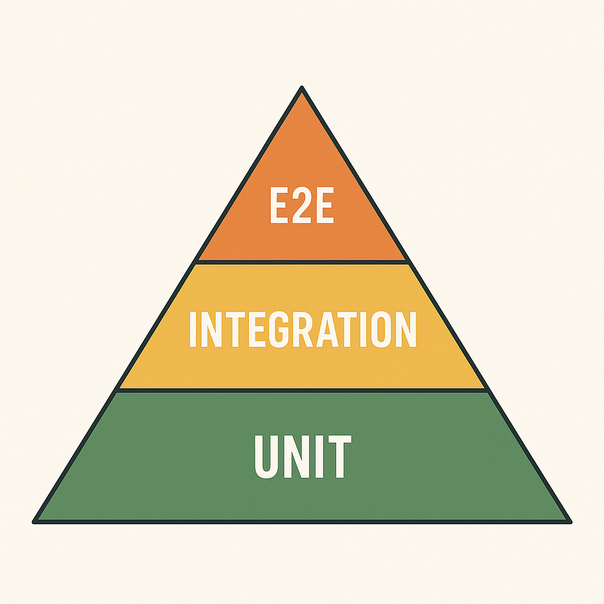

<h1>
  <span class="headline">TDD Fundamentals</span>
  <span class="subhead">End-to-End Testing</span>
</h1>

**Learning objective:** Create an end-to-end test that simulates a real user workflow through a full application stack.

## Why End-to-End Tests Matter: The Full User Journey

You’ve practiced unit and integration tests. But how do you know your **entire system** behaves like a user expects? That’s where end-to-end (E2E) testing comes in.

E2E tests simulate the complete user experience, from browser interaction through the frontend, backend, and mock database.

> **Real-world analogy:** Like taking a train from start to finish, verifying that all parts work together—ticket machine, platform, train ride, and arrival.

## E2E in the Testing Pyramid

- **Unit tests:** Small, fast, and numerous.
- **Integration tests:** Combine internal parts.
- **E2E tests:** Simulate critical user workflows.



> E2E tests are slower but cover full system interactions. Use them for key flows like form submissions, logins, or data lookups.

## Tools You Already Have

Assuming you've already set up:

- FastAPI (backend)
- A frontend HTML file (`tracking.html`)
- Selenium + `webdriver-manager`
- ChromeDriver

<div class="activity partner-exercise">
  <h2 class="title">Simulating a Package Tracking Lookup</h2>
  <span class="minutes">15 min</span>
</div>

We'll now automate a complete user interaction in your **Package Tracking App**.

We’ll simulate a user:

- Opening the page
- Entering a tracking number
- Clicking "Track"
- Viewing the package status returned from the FastAPI backend

### HTML (`tracking.html`)

Your form should have the following structure:

```html
<div class="tracker">
  <h2>Track Your Package</h2>
  <input type="text" id="tracking-number" placeholder="Enter tracking number" />
  <button id="track-btn" onclick="trackPackage()">Track</button>
  <div id="result"></div>
</div>
```

## Backend (`main.py`)

```python
from fastapi import FastAPI, HTTPException
from fastapi.responses import HTMLResponse
from fastapi.staticfiles import StaticFiles
from mock_db import TRACKING_DATA

app = FastAPI()

app.mount("/static", StaticFiles(directory=".", html=True), name="static")

@app.get("/track/{tracking_number}")
def track_package(tracking_number: str):
    if tracking_number in TRACKING_DATA:
        return {"status": TRACKING_DATA[tracking_number]}
    else:
        raise HTTPException(status_code=404, detail="Tracking number not found.")
```

<div class="activity solo-exercise">
  <h2 class="title">Write Your First E2E Test</h2>
  <span class="minutes">15 min</span>
</div>

Write an E2E test using Selenium to simulate a user tracking their package.

### Steps:

1. **Start your FastAPI app:**

   ```bash
   uvicorn main:app --reload
   ```

2. **Create a new file called 📄 `test_track_e2e.py`**

```python
from selenium import webdriver
from selenium.webdriver.common.by import By
from selenium.webdriver.support.ui import WebDriverWait
from selenium.webdriver.support import expected_conditions as EC

def test_track_package():
    driver = webdriver.Chrome()
    try:
        driver.get("http://localhost:8000/static/tracking.html")

        # Enter tracking number
        search_box = driver.find_element(By.ID, "tracking-number")
        search_box.send_keys("PKG123")

        # Click the track button
        driver.find_element(By.ID, "track-btn").click()

        # Wait for the status to appear
        status_div = WebDriverWait(driver, 10).until(
            EC.visibility_of_element_located((By.ID, "status"))
        )

        assert "In transit - Bahrain" in status_div.text

    finally:
        driver.quit()
```

> You just wrote a complete user simulation for a tracking request!

3. **Run the test**

Ina separate terminal window, run:

```bash
pytest test_track_e2e.py
```

✅ If everything is set up correctly, a Chrome window will open, simulate the user action, and your test will pass if the correct status appears.

<div class="activity discussion">
  <h2 class="title">Reflect</h2>
  <span class="minutes">2 min</span>
</div>

- What kinds of bugs might E2E tests catch that other tests miss?
- When should you avoid E2E and stick with unit/integration tests?
- How would you refactor your app to make this test easier?
